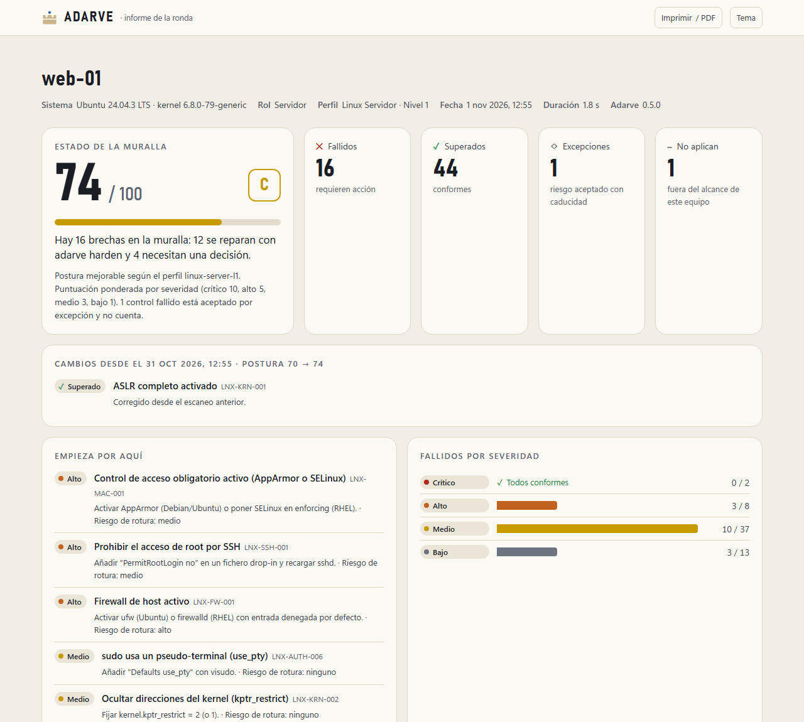
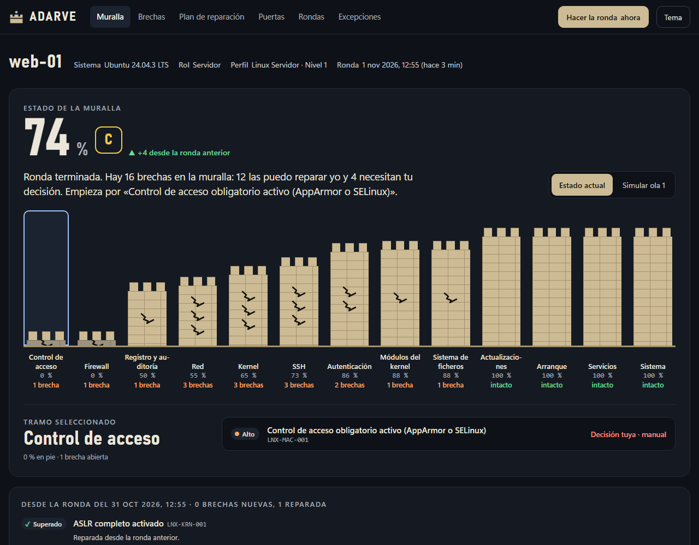

<div align="center">

# 🛡️ Adarve

**Auditoría y hardening para Windows, Windows Server y Linux**

Evalúa la configuración de seguridad de tus equipos frente a perfiles de hardening,
calcula una puntuación de postura, la mapea a MITRE ATT&CK y te dice qué corregir primero.

[](https://github.com/Ruby570bocadito/adarve/actions/workflows/ci.yml)
[](https://github.com/Ruby570bocadito/adarve/releases/latest)


[Instalación](#-instalación-en-una-línea) · [Uso](docs/10-guia-de-uso.md) · [Documentación](docs/README.md) · [Hoja de ruta](docs/13-hoja-de-ruta.md)

<sub>Antes se llamaba <b>Bastion</b>. Al actualizar con el instalador se traslada todo: historial, excepciones, instantáneas y la ronda diaria.</sub>

</div>

---



<details>
<summary>Consola local (<code>adarve ui</code>)</summary>



</details>

## ✨ Qué hace hoy

| | |
|---|---|
| 🔍 **Auditoría de solo lectura** | 157 controles reales para Windows 10/11, Windows Server 2016-2025 (miembro y DC) y Linux (Ubuntu, Debian, RHEL y derivados). `scan` nunca modifica el sistema. |
| 🛡️ **Hardening seguro** | `adarve harden` corrige 100 controles con simulación, instantánea previa, verificación y **rollback automático**; olas por riesgo de rotura y dead-man switch para SSH/RDP. |
| 🎯 **Perfiles por rol** | Estación de trabajo, servidor miembro, controlador de dominio y servidor Linux, con niveles L1/L2. Adarve detecta el rol y elige el perfil. |
| 📊 **Puntuación de postura** | Puntuación ponderada por severidad (0-100, A-F), por categoría y por severidad. |
| 📝 **Excepciones con caducidad** | Acepta un control fallido con motivo, responsable y fecha de caducidad (máximo un año): sale aparte, no cuenta y vuelve a fallar al caducar. |
| 🧭 **MITRE ATT&CK** | Cada control enlaza técnicas y mitigaciones. El informe muestra qué técnicas quedan expuestas. |
| 🧾 **Evidencias** | Para cada control: valor real, valor esperado y de dónde sale el dato (clave de registro, `sshd -T`, `secedit`...). |
| 🛠️ **Remediación guiada** | Para lo que no es automático: resumen, ruta de GPO, comandos listos para copiar, riesgo de rotura e impacto. |
| 🌐 **Informe HTML autocontenido** | Un solo fichero, modo claro y oscuro, filtros, sin conexión, imprimible a PDF. |
| 🌍 **Superficie de ataque** | `adarve surface` lista qué escucha en la red y con qué proceso, evalúa el firewall (Windows, nftables e iptables, que cubren ufw y firewalld) para decir si cada puerto está abierto a cualquiera, limitado o filtrado, y señala los servicios de riesgo expuestos (SMB, RDP, Redis, Docker API…) y los recursos compartidos abiertos a todos. |
| 🖥️ **Consola local** | `adarve ui` abre un panel en el navegador con la tendencia de la puntuación, el plan de hardening por olas, el historial y las excepciones. Solo en 127.0.0.1 y con token. |
| ⚙️ **Listo para CI/CD** | Salida JSON estable y `--min-score` para fallar un pipeline de imágenes doradas. |
| 🔄 **Auto-actualización firmada** | `adarve update` y los instaladores comprueban la firma de la release y la suma SHA-256 antes de instalar nada. Las reglas viajan dentro del binario. |

## 🚀 Instalación en una línea

El mismo comando **instala, actualiza, prepara y lanza un primer escaneo**. Vuelve a ejecutarlo cuando quieras actualizar.

**Linux** (como root):

```bash
curl -fsSL https://raw.githubusercontent.com/Ruby570bocadito/adarve/main/scripts/install.sh | sudo bash
```

**Windows** (PowerShell como administrador):

```powershell
irm https://raw.githubusercontent.com/Ruby570bocadito/adarve/main/scripts/install.ps1 | iex
```

Opciones, instalación sin conexión, espejos internos y desinstalación: [docs/09-instalacion.md](docs/09-instalacion.md).

## 🧪 Uso rápido

```bash
adarve info                        # plataforma, rol y perfil detectados
adarve scan                        # auditar con el perfil por defecto
adarve scan --save --open          # guardar y abrir el informe HTML
adarve ui                          # consola en el navegador: tendencia, plan e historial
adarve surface                     # qué puede tocar un atacante desde la red
adarve surface fix --apply         # limitar a la red local lo abierto a cualquiera (Windows, con rollback)
adarve schedule enable             # análisis diario: tendencia y aviso de cambios en la exposición
adarve schedule notify --set URL   # avisos en el móvil o en un chat (ntfy, Slack, Discord, Teams)
adarve scan -p win-workstation-l2  # otro perfil
adarve scan --format json          # salida JSON (integraciones)
adarve scan --min-score 80         # código de salida 2 si no llega (CI/CD)
adarve rules show WIN-NET-001      # detalle y remediación de un control
adarve harden                      # simulación: qué cambiaría (no toca nada)
adarve harden --apply              # corregir la ola 1 (riesgo nulo o bajo)
adarve rollback                    # deshacer el último cambio
adarve exceptions add LNX-FW-001 --reason "Filtrado en el perímetro" --expires 90d
adarve update                      # actualizar Adarve y sus reglas
```

```text
  ▲ ADARVE  · auditoría de hardening  0.1.0
  ────────────────────────────────────────────────────────────────────────
  Equipo    web-01 · Ubuntu 24.04.1 LTS · kernel 6.8.0 · amd64
  Perfil    Linux Servidor · Nivel 1 (linux-server-l1)
  Escaneo   57 controles en 39 ms

  POSTURA    65/100 D  ███████████████████████░░░░░░░░░░░░░
           ✓ 22 superados   ✗ 15 fallidos   ! 0 errores   ○ 20 no aplican

  FALLIDOS (15)
  ✗ ALTO     LNX-FW-001    Firewall de host activo
                           ufw: actual no configurado · esperado yes
  ✗ ALTO     LNX-MAC-001   Control de acceso obligatorio activo (AppArmor o SELinux)
  ...
```

## 🗺️ Hacia dónde va

**La v1.0** es la mejor herramienta para endurecer **un equipo**: auditar Windows 11, Windows Server 2022 y Ubuntu 24.04, endurecerlos con rollback y entregar un informe defendible, sin falsos positivos conocidos y con releases firmadas.

| Bloque | Qué falta |
|---|---|
| Identidad | Renombrado a Adarve, informes con la nueva identidad, capturas y GIF |
| Confianza | Releases firmadas, análisis de seguridad y *fuzzing* en CI, instaladores probados de punta a punta |
| Precisión | Laboratorio con *golden files* en 3 sistemas, estado `manual` |
| Estabilidad | Esquemas congelados y guía de operación |

Detalle y estado de cada tarea en la [hoja de ruta](docs/13-hoja-de-ruta.md). La flota, la defensa y el modo enterprise son la [visión a largo plazo](docs/15-vision-a-largo-plazo.md), después de la v1.0.

## 🔐 Principios de seguridad

- **Nada cambia sin pedirlo.** `scan` es de solo lectura y `harden` es una simulación salvo que se use `--apply`. Cada cambio guarda antes el estado previo, se verifica y se revierte si falla.
- **Sin ejecución arbitraria.** Las reglas son datos declarativos: un paquete de reglas no puede ejecutar comandos. Los comandos del sistema que usan los probes están fijados en el código y se invocan con ruta absoluta.
- **Releases firmadas.** El instalador y `adarve update` comprueban la firma de `checksums.txt` con la clave pública que llevan dentro y después la suma SHA-256 del archivo.
- **Informe blindado.** Los datos leídos del sistema nunca se interpretan como HTML y la página tiene una CSP con nonce.

Más en [docs/08-seguridad-de-la-plataforma.md](docs/08-seguridad-de-la-plataforma.md). Para reportar vulnerabilidades: [SECURITY.md](SECURITY.md).

## 📚 Documentación

Toda la documentación está en [`docs/`](docs/README.md): visión, arquitectura, herramientas, motor de reglas, remediación segura, catálogo de controles, diseño de la UI, seguridad, instalación, guía de uso, desarrollo, pruebas, hoja de ruta, marcos normativos y decisiones de arquitectura (ADR).

## 🧑‍💻 Desarrollo

```bash
make build        # bin/adarve
make test         # tests
make lint         # gofmt + go vet (Linux y Windows)
make rules-lint   # validar el paquete de reglas
sudo make scan    # escanear este equipo
```

Guía completa: [docs/11-desarrollo.md](docs/11-desarrollo.md).
