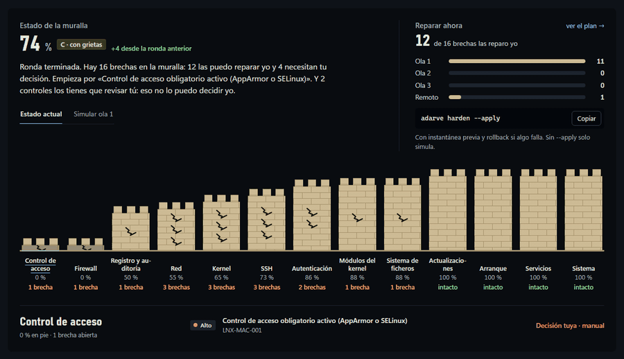
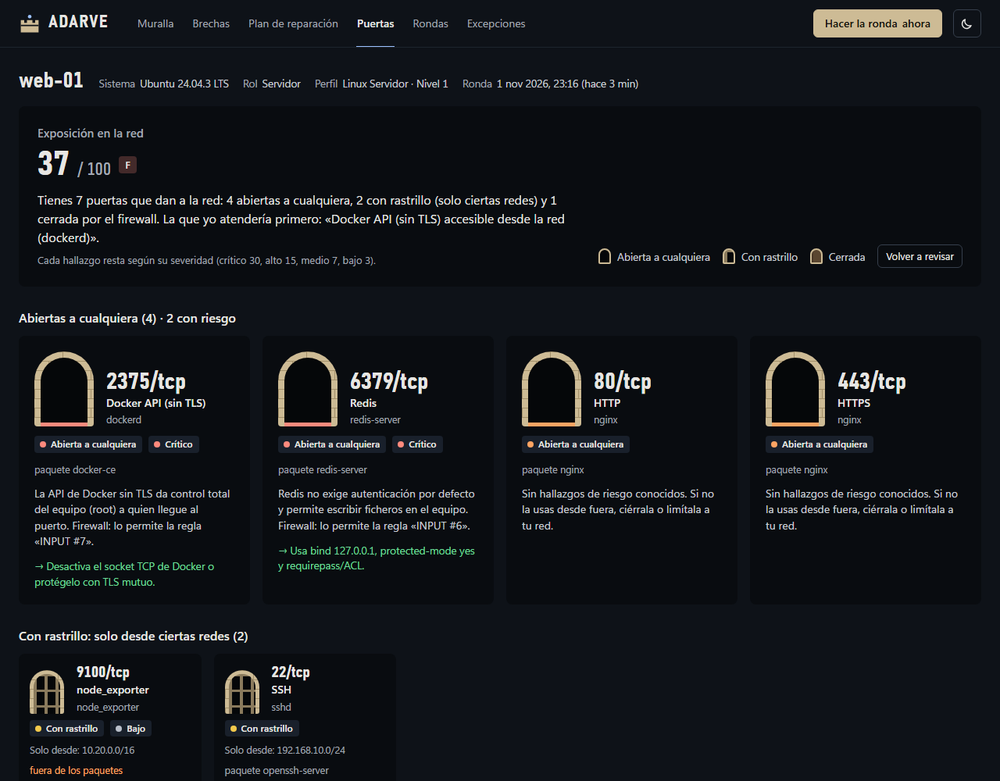

# 07 · UI y diseño

Adarve tiene hoy dos superficies visuales: la **consola** y el **informe HTML**. La **consola web de flota** llegará en la fase 3. Las tres comparten el mismo lenguaje visual.



| | |
|---|---|
|  |  |

Las capturas salen de datos de demostración (un servidor ficticio, `web-01`) y se regeneran con `node scripts/demo/capturas.mjs` (ver [11 · Desarrollo](11-desarrollo.md#datos-de-demostración-y-capturas)).

## Identidad: el adarve

El adarve es el camino de ronda en lo alto de la muralla, por donde el centinela la recorre y comprueba que está entera. Esa es la metáfora de toda la interfaz:

| En el código | En la interfaz |
|---|---|
| `scan` | la ronda |
| puntuación | el estado de la muralla (68 %) |
| control fallido | brecha |
| categoría | tramo |
| `harden` | reparar |
| `surface` | las puertas |
| `schedule` | la ronda diaria |

La voz es la de un centinela tranquilo: habla en primera persona, dice qué repara él y qué decides tú, y nunca asusta sin dar una salida («Hay 14 brechas: 10 las reparo yo solo y 4 necesitan tu decisión»). La metáfora vive en los textos y en la consola; los comandos y el informe para auditores mantienen los términos técnicos («Fallidos», «Superados»).

## Principios

1. **Los datos son lo único que "grita".** Superficies planas, sin sombras, degradados ni brillos, y el color reservado para el estado. La tarjeta se separa del fondo por un escalón de tono: de noche es más oscura que el fondo y no lleva borde.
2. **El color nunca va solo.** Cada estado o severidad lleva su nombre escrito junto al punto de color («Fallido», «Superado», «Alto»), sin depender de iconos ni emoji. Esto hace los informes legibles con daltonismo y al imprimir en blanco y negro.
3. **Una cifra principal por vista.** La puntuación de postura es la cifra principal (44 px); el recuento va en filas a su lado y el resto son gráficos pequeños. Nada pasa de 48 px: es una herramienta de trabajo, no una portada.
4. **La selección es una línea de luna.** La pestaña activa, el modo elegido, el tramo pulsado o la ronda actual se marcan con una línea de 1 px del color luna, del ancho de su etiqueta; no con fondos ni recuadros.
5. **Títulos en frase normal.** Sin versalitas ni letras espaciadas; los títulos de tarjeta van a 15 px en el color del texto y los números, en cifras tabulares para que no bailen al actualizarse.
6. **Claro y oscuro de verdad.** Cada tema tiene sus propios valores de color; el oscuro no es una inversión automática del claro. Se respeta `prefers-color-scheme` y hay un selector manual (el botón de luna y sol).
7. **Accesible.** Navegable con teclado (`<details>`, botones reales), foco visible, `aria-pressed` en los filtros, contraste AA también de día (los textos naranja y amarillo usan su variante oscura) y diseño adaptable hasta 375 px sin scroll horizontal. En el móvil, la muralla se lee en filas.

## Tokens de diseño

Tres colores de marca: **noche** (el fondo), **piedra** (la muralla) y **luna** (enlaces y acción). El tema oscuro es el de la marca y el que abre la consola; el informe, que se comparte e imprime, parte del claro.

| Rol | Día (claro) | Noche (oscuro) |
|---|---|---|
| Página | `#f0efec` | `#0e1218` |
| Superficie (tarjeta) | `#fbfbfa` | `#090c10` |
| Texto principal | `#1a1d23` | `#e7e6e3` |
| Texto secundario | `#3d4250` | `#c9cdd4` |
| Línea fina | `#dedbd4` | `#1d242e` |
| Piedra (la muralla) | `#c9b48a` | `#cdbb95` |
| Luna (enlaces, acción y selección) | `#2f5fa8` | `#9cc2ff` |

El día es un hueso casi neutro, no una crema: la calidez la pone la piedra.

### Paleta de estado (fija, nunca tematizada)

| Rol | Día | Noche | Uso en Adarve |
|---|---|---|---|
| good | `#2e9a5a` (texto `#1f7a43`) | `#6fd99a` | Superado, intacto, puntuación ≥ 80 |
| warning | `#c79a00` (texto `#8a6a00`) | `#f2c94c` | Severidad media, errores, puntuación 60-79 |
| serious | `#c2621f` (texto `#a14e15`) | `#ffa463` | Severidad alta, brechas |
| critical | `#b3261e` | `#ff8a7d` | Severidad crítica, puntuación < 60 |
| neutral | `#6e7381` | `#b9bfca` | Severidad baja, no aplica |

De día, el color de estado rellena puntos, barras y torres; cuando es texto se usa la variante «texto», que pasa 4,5:1 sobre la tarjeta. La calificación («C · Mejorable») va en el color del texto sobre un fondo teñido de su estado.

Tipografía: Bahnschrift (en Windows; en otros sistemas, una condensada del sistema) para las cifras grandes y los títulos, y la del sistema para el texto. Monoespaciada para IDs, rutas y valores (`ui-monospace`, Cascadia Code, Consolas). Sin fuentes externas: la CSP de la consola y del informe no permite cargarlas. Las etiquetas largas de la muralla se parten por sílabas, con guion.

Texturas: el aparejo de los sillares, las rejas del rastrillo y la puerta cerrada son SVG pequeños en `data:` (la CSP permite `img-src data:`), repetidos como fondo; ni degradados ni imágenes externas.

## Informe HTML (✅)

| Bloque | Forma | Por qué |
|---|---|---|
| Postura | Cifra principal (44 px), calificación A-F con su palabra, medidor y la frase del centinela | Es el dato que se busca primero |
| Fallidos / superados / sin evaluar o excepciones / revisión manual o no aplican | Recuento en filas, en la misma tarjeta que la postura | Cuatro números de cabecera; un gráfico añadiría ruido |
| Empieza por aquí | Lista priorizada (severidad y riesgo de rotura) | Convierte el informe en un plan |
| Fallidos por severidad | Barras horizontales con escala compartida y valor al final, junto a la lista | Comparar magnitudes de una categoría ordinal |
| Técnicas ATT&CK expuestas | Fichas enlazadas a attack.mitre.org, bajo la severidad | Pasa del lenguaje de cumplimiento al de amenazas |
| La muralla por tramos | Una torre por categoría: su altura es la puntuación y cada grieta, un control fallido; de la más dañada a la más firme | Una proporción frente a un límite, con la metáfora de la consola |
| Controles evaluados | Tabla filtrable (estado, severidad, categoría, búsqueda) con detalle desplegable | Es la vista de tabla: todo valor es accesible sin depender de gráficos ni tooltips |

Cada control desplegado muestra la descripción, por qué importa, el **árbol de evidencias** (subcomprobaciones con valor actual, esperado y origen), la remediación (GPO y comandos con botón Copiar), el riesgo de rotura, el impacto y las referencias.

Características técnicas:

- **Un único fichero** sin dependencias externas: funciona sin conexión, se adjunta a un correo y se imprime a PDF (estilos de impresión incluidos).
- **Seguro ante datos hostiles**: ver [08-seguridad-de-la-plataforma.md](08-seguridad-de-la-plataforma.md#informe-html).
- El tema elegido se recuerda en `localStorage` (si está disponible).

## Consola local: `adarve ui` (✅)

| La muralla | Las puertas |
|---|---|
|  |  |

Un panel en el navegador para trabajar con un equipo, no solo mirar una foto. Se sirve desde el propio binario en `127.0.0.1` con un token por sesión y no tiene dependencias externas ([ADR-0008](adr/0008-consola-local.md)). Solo mira y hace rondas: las reparaciones se aplican desde la terminal.

| Pestaña | Contenido |
|---|---|
| **Muralla** | Arriba, el estado de la muralla con la calificación, la variación desde la ronda anterior y una frase que resume qué repara Adarve y qué decides tú; a su lado, **Reparar ahora**: cuántas brechas repara él, repartidas por olas, y el comando listo para copiar. Cada **tramo** es una categoría: su altura es la puntuación (los sillares, en aparejo) y cada grieta, una brecha; al pulsarlo se ven sus brechas (en el móvil, la muralla se lee en filas). **Simular ola 1, 2 o 3** recalcula la puntuación como si se aplicara (misma fórmula que el motor) y los tramos crecen. Debajo: prioridades y lo que cambió desde la ronda anterior; a la derecha, las rondas como torres (cada una abre esa ronda) y las brechas por severidad |
| **Brechas** | El informe HTML de la ronda, incrustado y abierto directamente en la tabla de controles |
| **Plan de reparación** | La simulación de `harden` para la ola 1, 2 o 3: el cambio «actual → nuevo» de cada control y qué queda para otra ola, para el acceso remoto, para la GPO o es manual |
| **Puertas** | Los puertos que escuchan en la red, agrupados por programa: **abiertas a cualquiera**, **con rastrillo** (solo desde ciertas redes) o **cerradas** por el firewall, con su hallazgo y cómo cerrarlas; la tabla completa, los recursos compartidos y quién tiene las llaves (administradores) |
| **Rondas** | La ronda diaria (`schedule`) y sus ejecuciones, las rondas guardadas con su puntuación y variación, y las reparaciones aplicadas con el comando para deshacerlas |
| **Excepciones** | Vigencia de cada excepción: en naranja si caduca en menos de 30 días, en rojo si ha caducado |

Al abrirla hace una ronda si la última tiene más de una hora. El botón **Hacer la ronda** añade una torre a las rondas. Temas noche (por defecto) y día con el botón de luna y sol, y diseño adaptable hasta 375 px sin scroll horizontal.

## Consola de texto (✅)

- Colores ANSI solo cuando la salida es una terminal y no está activo `NO_COLOR`/`--no-color`.
- En Windows se activa el modo VT. En la consola clásica (conhost), los símbolos Unicode que su fuente no tiene se sustituyen (✓ → √, ✗ → ×).
- Barra de progreso en stderr para no ensuciar la salida JSON.

## Consola web de flota (🔜 fase 3)

**Stack:** React + TypeScript + Vite + Tailwind + shadcn/ui + TanStack Query/Table + ECharts + Framer Motion. El mismo sistema de tokens que el informe.

```
┌─ ADARVE ──────────────────────────────────────────── Ctrl+K   🔔   👤 ┐
│              │  Postura global          Por plataforma                 │
│ ▸ Dashboard  │    ╭──────╮              Windows 11   ████████░░  82    │
│   Activos    │    │  78  │  ▲ +6 / 30d  Server 2022  ██████░░░░  64    │
│   Políticas  │    ╰──────╯              Linux        ████████░░  79    │
│   Hardening  │ ─────────────────────────────────────────────────────── │
│   Defensa    │  Controles más fallidos       Cobertura MITRE ATT&CK     │
│   Informes   │  ● SMBv1 habilitado    42 eq   ▓▓▓▓░░▓▓▓░▓▓░░▓▓        │
│   Excepciones│  ● LLMNR activo        38 eq   ▓▓░░░▓▓▓▓▓░▓▓▓░░        │
│   Ajustes    │  ● Root login SSH      12 eq   ▓▓▓▓▓▓░░▓▓▓▓▓▓▓▓        │
└──────────────┴─────────────────────────────────────────────────────────┘
```

| Pantalla | Contenido |
|---|---|
| Dashboard | Postura global y tendencia, por plataforma, controles más fallidos, mapa ATT&CK (mitigación y detección) |
| Activos | Tabla con filtros, etiquetas y puntuación por equipo |
| Detalle de equipo | Lo mismo que el informe HTML, con historial y botón "Corregir" |
| Políticas (`studio`) | Editor de perfiles con herencia, parámetros, overrides, importación y exportación |
| Plan de hardening | Diff, avisos de impacto, datos de `observe`, olas, anillos y aprobación |
| Defensa | Superficie de ataque, telemetría, hallazgos de `hunt`, `lockdown` |
| Informes | Ejecutivo, técnico, por marco, diferencial |
| Excepciones | Solicitudes, aprobaciones y caducidades |
| Historial | Línea de tiempo de cambios con rollback de un clic |

Reglas de interacción: un único bloque de filtros por vista que afecta a todos los gráficos; tooltips que complementan pero nunca son la única forma de leer un dato; tabla equivalente para cada gráfico; paleta de comandos (Ctrl+K).
