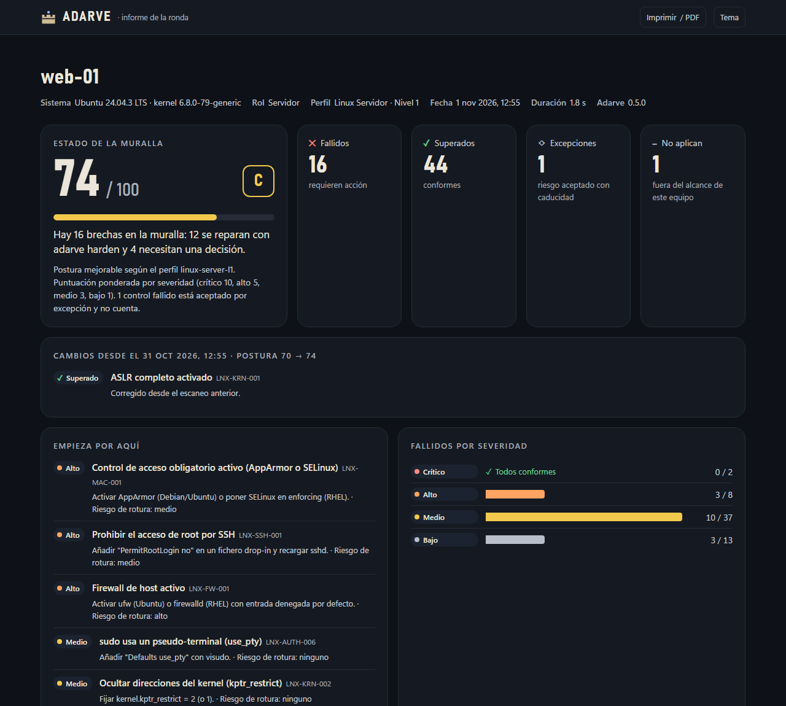

# 07 · UI y diseño

Adarve tiene hoy dos superficies visuales: la **consola** y el **informe HTML**. La **consola web de flota** llegará en la fase 3. Las tres comparten el mismo lenguaje visual.

| | |
|---|---|
|  |  |

## Principios

1. **Los datos son lo único que "grita".** Superficies neutras, bordes de un píxel y el color reservado para el estado.
2. **El color nunca va solo.** Cada estado o severidad lleva icono y texto (✕ Fallido, ✓ Superado, ! Error, – No aplica). Esto hace los informes legibles con daltonismo y al imprimir en blanco y negro.
3. **Una cifra principal por vista.** La puntuación de postura es la cifra principal; el resto son tiras KPI y gráficos pequeños.
4. **Claro y oscuro de verdad.** Cada tema tiene sus propios valores de color; el oscuro no es una inversión automática del claro. Se respeta `prefers-color-scheme` y hay un selector manual.
5. **Accesible.** Navegable con teclado (`<details>`, botones reales), foco visible, `aria-pressed` en los filtros y diseño adaptable hasta 390 px sin scroll horizontal.

## Tokens de diseño

| Rol | Claro | Oscuro |
|---|---|---|
| Página | `#f6f6f3` | `#0d0d0d` |
| Superficie (tarjeta) | `#fcfcfb` | `#1a1a19` |
| Texto principal | `#0b0b0b` | `#f0efec` |
| Texto secundario | `#52514e` | `#c3c2b7` |
| Línea fina | `#e1e0d9` | `#2c2c2a` |
| Acento (marca) | `#2a78d6` | `#3987e5` |

### Paleta de estado (fija, nunca tematizada)

| Rol | Color | Uso en Adarve |
|---|---|---|
| good | `#0ca30c` | Superado, puntuación ≥ 80 |
| warning | `#fab219` | Severidad media, errores, puntuación 60-79 |
| serious | `#ec835a` | Severidad alta |
| critical | `#d03b3b` | Severidad crítica, fallido, puntuación < 60 |
| neutral | `#898781` | Severidad baja, no aplica |

Tipografía: la del sistema (`system-ui`, Segoe UI, Roboto). Monoespaciada para IDs, rutas y valores (`ui-monospace`, Cascadia Code, Consolas). Los números grandes usan cifras proporcionales y las columnas alineadas usan `tabular-nums`.

## Informe HTML (✅)

| Bloque | Forma | Por qué |
|---|---|---|
| Postura | Cifra principal (64 px) + calificación A-F + medidor | Es el dato que se busca primero |
| Fallidos / superados / sin evaluar o excepciones / no aplican | Tiras KPI | Cuatro números de cabecera; un gráfico añadiría ruido |
| Empieza por aquí | Lista priorizada (severidad y riesgo de rotura) | Convierte el informe en un plan |
| Fallidos por severidad | Barras horizontales con escala compartida y valor al final | Comparar magnitudes de una categoría ordinal |
| Puntuación por categoría | Medidores 0-100, peores primero | Una proporción frente a un límite |
| Técnicas ATT&CK expuestas | Fichas enlazadas a attack.mitre.org | Pasa del lenguaje de cumplimiento al de amenazas |
| Controles evaluados | Tabla filtrable (estado, severidad, categoría, búsqueda) con detalle desplegable | Es la vista de tabla: todo valor es accesible sin depender de gráficos ni tooltips |

Cada control desplegado muestra la descripción, por qué importa, el **árbol de evidencias** (subcomprobaciones con valor actual, esperado y origen), la remediación (GPO y comandos con botón Copiar), el riesgo de rotura, el impacto y las referencias.

Características técnicas:

- **Un único fichero** sin dependencias externas: funciona sin conexión, se adjunta a un correo y se imprime a PDF (estilos de impresión incluidos).
- **Seguro ante datos hostiles**: ver [08-seguridad-de-la-plataforma.md](08-seguridad-de-la-plataforma.md#informe-html).
- El tema elegido se recuerda en `localStorage` (si está disponible).

## Consola local: `adarve ui` (✅)


Un panel en el navegador para trabajar con un equipo, no solo mirar una foto. Se sirve desde el propio binario en `127.0.0.1` con un token por sesión y no tiene dependencias externas ([ADR-0008](adr/0008-consola-local.md)).

| Pestaña | Contenido |
|---|---|
| **Panel** | Postura con la variación desde el escaneo anterior, KPIs, **tendencia** de la puntuación (SVG, cada punto abre ese escaneo), **corrección automática** (cuántos fallidos se corrigen solos, por ola) con el comando listo para copiar, prioridades, severidad y categorías más débiles |
| **Controles** | El informe HTML del escaneo, incrustado y abierto directamente en la tabla de controles |
| **Plan de hardening** | La simulación de `harden` para la ola 1, 2 o 3: el diff "actual → nuevo" de cada cambio y qué queda para otra ola, para el acceso remoto, para la GPO o es manual |
| **Historial** | Escaneos guardados con su puntuación y variación (se puede abrir cualquiera) y los cambios de hardening aplicados, con el comando para deshacerlos |
| **Excepciones** | Vigencia de cada excepción: en naranja si caduca en menos de 30 días, en rojo si ha caducado |

Al abrirla escanea si el último escaneo tiene más de una hora. El botón **Escanear ahora** añade un punto a la tendencia. Mismos tokens, temas claro y oscuro y comportamiento responsive que el informe.

## Consola de texto (✅)

- Colores ANSI solo cuando la salida es una terminal y no está activo `NO_COLOR`/`--no-color`.
- En Windows se activa el modo VT. En la consola clásica (conhost), los símbolos Unicode que su fuente no tiene se sustituyen (✓ → √, ✗ → ×).
- Barra de progreso en stderr para no ensuciar la salida JSON.

## Consola web de flota (🔜 fase 3)

**Stack:** React + TypeScript + Vite + Tailwind + shadcn/ui + TanStack Query/Table + ECharts + Framer Motion. El mismo sistema de tokens que el informe.

```
┌─ ADARVE ──────────────────────────────────────────── Ctrl+K   🔔   👤 ┐
│              │  Postura global          Por plataforma                 │
│ ▸ Dashboard  │    ╭──────╮              Windows 11   ████████░░  82    │
│   Activos    │    │  78  │  ▲ +6 / 30d  Server 2022  ██████░░░░  64    │
│   Políticas  │    ╰──────╯              Linux        ████████░░  79    │
│   Hardening  │ ─────────────────────────────────────────────────────── │
│   Defensa    │  Controles más fallidos       Cobertura MITRE ATT&CK     │
│   Informes   │  ● SMBv1 habilitado    42 eq   ▓▓▓▓░░▓▓▓░▓▓░░▓▓        │
│   Excepciones│  ● LLMNR activo        38 eq   ▓▓░░░▓▓▓▓▓░▓▓▓░░        │
│   Ajustes    │  ● Root login SSH      12 eq   ▓▓▓▓▓▓░░▓▓▓▓▓▓▓▓        │
└──────────────┴─────────────────────────────────────────────────────────┘
```

| Pantalla | Contenido |
|---|---|
| Dashboard | Postura global y tendencia, por plataforma, controles más fallidos, mapa ATT&CK (mitigación y detección) |
| Activos | Tabla con filtros, etiquetas y puntuación por equipo |
| Detalle de equipo | Lo mismo que el informe HTML, con historial y botón "Corregir" |
| Políticas (`studio`) | Editor de perfiles con herencia, parámetros, overrides, importación y exportación |
| Plan de hardening | Diff, avisos de impacto, datos de `observe`, olas, anillos y aprobación |
| Defensa | Superficie de ataque, telemetría, hallazgos de `hunt`, `lockdown` |
| Informes | Ejecutivo, técnico, por marco, diferencial |
| Excepciones | Solicitudes, aprobaciones y caducidades |
| Historial | Línea de tiempo de cambios con rollback de un clic |

Reglas de interacción: un único bloque de filtros por vista que afecta a todos los gráficos; tooltips que complementan pero nunca son la única forma de leer un dato; tabla equivalente para cada gráfico; paleta de comandos (Ctrl+K).
